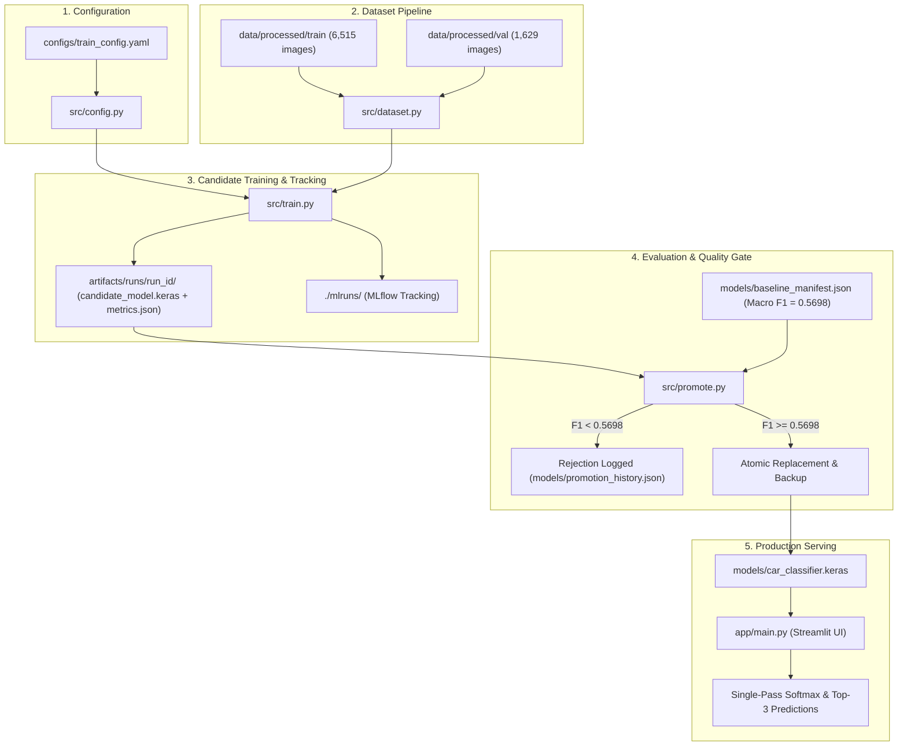

# Automotive Image Classifier (DLOps Workflow)

An end-to-end, production-grade Deep Learning Operations (DLOps) workflow for 196-class fine-grained automotive image classification using TensorFlow, EfficientNetB0, MLflow, and Streamlit.

---

## 1. Project Overview & Objectives

The goal of this project is to transform an initial image classification prototype into a reproducible, traceable, and testable production system.

### Key Highlights
- **Fine-Grained Classification**: Classifies car images across 196 makes, models, and years from the Stanford Cars dataset.
- **Configuration-Driven Architecture**: Centralized hyperparameter and environment settings via `configs/train_config.yaml`.
- **Local Experiment Tracking**: Detailed run tracking (per-epoch losses, accuracy, macro metrics, confusion matrices) logged locally using MLflow.
- **Quality Gates & Safe Model Promotion**: Candidate models are isolated under `artifacts/runs/<run_id>/` and can only be promoted to production serving if their validation Macro F1 meets or exceeds the verified baseline (`>= 0.5698`).
- **Rollback Protection & Auditability**: Atomic replacement (`os.replace`), pre-promotion shape/forward-pass validation, automatic timestamped backups, and SHA-256 audit logging.
- **Interactive Serving App**: Streamlit web interface featuring single-pass softmax inference, dynamic model caching with file-modification tracking, collapsible verified metadata, and robust input validation.
- **Continuous Integration**: Automated test suite with 35 tests running in under 12 seconds via GitHub Actions.

---

## 2. Architecture & DLOps Lifecycle



---

## 3. Repository Directory Structure

```text
automotive-classification/
├── .github/
│   └── workflows/
│       └── ci.yml                     # GitHub Actions CI workflow (lightweight tests)
├── app/
│   ├── main.py                        # Streamlit web application
│   └── utils.py                       # Inference helpers (preprocessing, single-pass softmax, metadata)
├── configs/
│   └── train_config.yaml              # Centralized hyperparameters, paths, and MLflow settings
├── data/                              # Stanford Cars dataset (excluded from Git)
│   ├── car_devkit/                    # Original devkit metadata
│   ├── cars_train/                    # Raw training images
│   └── processed/                     # Split dataset (train: 6,515 images, val: 1,629 images)
├── models/
│   ├── car_classifier.keras           # Production serving model (EfficientNetB0, SHA-256 verified)
│   ├── car_classifier_baseline_backup.keras # Protected baseline backup model
│   ├── classes.txt                    # Sorted list of 196 car classes
│   ├── class_mapping.json             # Index-to-class and class-to-index dictionary
│   ├── baseline_manifest.json         # Verified baseline evaluation benchmark metrics
│   ├── confusion_matrix.json          # Baseline 196x196 confusion matrix
│   └── promotion_history.json         # Durable audit log of candidate promotion & rollback events
├── src/
│   ├── config.py                      # YAML config parser and schema validator
│   ├── dataset.py                     # TensorFlow input pipeline (train augmentation, val deterministic)
│   ├── evaluate.py                    # Standalone model evaluation with macro F1 and confusion matrix
│   ├── model.py                       # EfficientNetB0 architecture and unfreezing logic
│   ├── prepare_data.py                # Raw dataset parsing and train/val split generation
│   ├── promote.py                     # Quality gate validation, atomic model promotion, and rollback CLI
│   └── train.py                       # Training loop with MLflow per-epoch callback and artifact logging
├── tests/
│   ├── test_app_helpers.py            # Tests for Streamlit preprocessing, formatting, and validation
│   ├── test_config.py                 # Tests for config loading, defaults, and error handling
│   ├── test_dataset.py                # Tests for data loading shapes, classes, and deterministic ordering
│   ├── test_metrics.py                # Tests for accuracy, precision, recall, macro F1, and evaluation
│   ├── test_model.py                  # Tests for model architecture, forward pass, and unfreezing
│   └── test_promotion.py              # Tests for quality gates, SHA-256 hashing, atomic staging, rollback
├── requirements.txt                   # Dependency specifications
└── README.md                          # Project documentation
```

---

## 4. Technology Stack & Prerequisites

- **Language**: Python 3.11, 3.12, or 3.13
- **Framework**: TensorFlow 2.13+ (tested with TensorFlow 2.21.0 on CPU)
- **Experiment Tracking**: MLflow 2.8+ / 3.x (local filesystem store `./mlruns/`)
- **Web UI**: Streamlit 1.28+ / 1.58+
- **Metrics & Science**: Scikit-learn, NumPy, SciPy, Pillow, Matplotlib, PyYAML
- **Testing**: Pytest 7.4+ / 9.1+

---

## 5. Dataset Details & Splitting

The Stanford Cars dataset consists of 8,144 automotive images categorized into **196 fine-grained classes**.
- **Training Set**: 6,515 images (80%) located in `data/processed/train/`
- **Validation Set**: 1,629 images (20%) located in `data/processed/val/`
- **Overlap**: Verified 0 file overlap between training and validation directories.
- **Ordering**: Classes are alphabetically sorted (Index `0`: `AM General Hummer SUV 2000` through Index `195`: `Volvo XC90 SUV 2007`).

---

## 6. Baseline Benchmark Metrics

The production baseline model (`models/car_classifier.keras`) was evaluated against the entire validation split (`data/processed/val/`, 1,629 images) using deterministic unbatched evaluation.

> [!NOTE]
> These figures represent **baseline validation split metrics**, not held-out test or real-world production performance. The model is a functional transfer-learning baseline, not a state-of-the-art classifier.

| Metric | Baseline Score | Context / Scope |
|---|---|---|
| **Validation Loss** | `1.6796` | Categorical cross-entropy on validation set |
| **Accuracy** | `57.34%` | Exact top-1 class match across 1,629 samples |
| **Macro F1 Score** | `0.5698` | Unweighted average across all 196 classes (**Promotion Quality Gate**) |
| **Macro Precision** | `0.6338` | Average class precision |
| **Macro Recall** | `0.5739` | Average class recall |

---

## 7. Setup & Execution Guide (Windows PowerShell)

All commands are tested and optimized for Windows PowerShell from the repository root.

### A. Environment Setup
```powershell
# 1. Create a virtual environment
python -m venv venv

# 2. Activate virtual environment
.\venv\Scripts\Activate.ps1

# 3. Install dependencies
pip install -r requirements.txt
```

### B. Validate Configuration
```powershell
python -c "from src.config import load_config; cfg = load_config('configs/train_config.yaml'); print('Config loaded successfully. Model:', cfg['model']['name'])"
```

### C. Run the Unit Test Suite
The complete test suite runs against synthetic fixtures and temporary directories without requiring dataset downloads or touching production model weights:
```powershell
python -m pytest tests/ -v
```

### D. Evaluate Serving Model Against Validation Data
```powershell
python src/evaluate.py --model-path models/car_classifier.keras --val-dir data/processed/val --classes-path models/classes.txt --output-dir models --manifest-name baseline_manifest.json
```

### E. Train a Candidate Model
> [!WARNING]
> Training executes transfer learning and fine-tuning. Candidate models are safely saved to `artifacts/runs/<run_id>/` and **never** overwrite `models/car_classifier.keras` directly.

```powershell
# Set MLflow filesystem compatibility on Windows
$env:MLFLOW_ALLOW_FILE_STORE="true"

# Execute training with a unique run identifier
python src/train.py --config configs/train_config.yaml --run-id candidate_run_01
```

### F. Launch MLflow Experiment Tracking UI
```powershell
$env:MLFLOW_ALLOW_FILE_STORE="true"
mlflow ui --backend-store-uri mlruns
```
Open your browser at `http://127.0.0.1:5000` to inspect hyperparameters, loss curves, confusion matrices, and run artifacts.

### G. Model Promotion Quality Gate
Model promotion is strictly manual and protected by a quality gate:

```powershell
python src/promote.py --run-id candidate_run_01
```

**Quality Gate Rules**:
1. Checks candidate integrity: input shape `(None, 224, 224, 3)` and 196 output classes.
2. Reads candidate Macro F1 and compares it against baseline `0.5698`.
3. If candidate Macro F1 is lower than `0.5698`, promotion is **rejected** and logged to `models/promotion_history.json`. Serving model is left untouched.
4. If candidate Macro F1 is $\ge 0.5698$, a timestamped backup is generated under `models/backups/`, the candidate is staged and atomically replaced with `os.replace`, and SHA-256 hashes are recorded.

### H. Model Rollback
If a promoted model exhibits unexpected behavior, it can be rolled back to any verified backup:

```powershell
python src/promote.py --rollback models/backups/car_classifier_backup_YYYYMMDD_HHMMSS.keras
```
*(Or rollback to baseline backup: `python src/promote.py --rollback models/car_classifier_baseline_backup.keras`)*

### I. Launch Streamlit Web Application
```powershell
streamlit run app/main.py
```
Open your browser at `http://localhost:8501`.
- Upload a car image (`.jpg`, `.jpeg`, `.png`).
- View the top-3 predictions with confidence scores.
- Expand the **Model Information** panel to inspect verified architecture details, status, and benchmark metrics.

---

## 8. Continuous Integration (GitHub Actions)

A GitHub Actions workflow is defined in [`.github/workflows/ci.yml`](file:///.github/workflows/ci.yml).
- **Triggers**: Push and pull requests on `main` and `master`.
- **Environment**: `ubuntu-latest`, Python `3.11`.
- **Steps**:
  1. Installs dependencies from `requirements.txt` with pip caching.
  2. Validates configuration loading.
  3. Executes all 35 unit tests (`pytest tests/ -v`).
- **Safety**: Does not download dataset binaries, run full training, start web servers, or modify models in CI.

---

## 9. Troubleshooting & Common Issues

| Issue | Cause | Resolution |
|---|---|---|
| **MLflow Store Warning on Windows** | MLflow 3+ flags local file-based URIs on Windows. | Set `$env:MLFLOW_ALLOW_FILE_STORE="true"` before running MLflow CLI or scripts. |
| **Terminal Character Encoding Warning** | Default Windows console encoding (`cp1252`) may fail on Unicode characters. | Set `$env:PYTHONIOENCODING="utf-8"` in PowerShell before executing scripts. |
| **TensorFlow GPU Notification** | Native Windows TensorFlow $\ge 2.11$ operates on CPU by default. | Normal behavior on native Windows; for GPU acceleration, run inside WSL2 or use TensorFlow-DirectML. |
| **Double Softmax Confidence Distortion** | Re-applying `softmax` on model output that already has `activation='softmax'`. | Resolved in `app/utils.py`; raw prediction probabilities are used directly. |
| **Missing Model Warning in Streamlit** | `models/car_classifier.keras` missing. | Ensure model weights are located in `models/car_classifier.keras` or restore from backup. |

---

## 10. Limitations & Future Roadmap

- **Baseline Performance**: The current model achieves 57.34% validation accuracy across 196 classes. In fine-grained classification, visually similar models (e.g., coupes vs. sedans of the same maker) may be misclassified. During real-image smoke testing, an Acura Integra was predicted as a Ferrari California Convertible at 50.12% confidence, reflecting expected baseline error bounds.
- **Single Validation Split**: Evaluation uses a single 80/20 train/val split without a secondary held-out test split. Future iterations should add cross-validation or an external test split.
- **Future Improvements**:
  - Fine-tune higher-capacity architectures (e.g., EfficientNetB3, ConvNeXt).
  - Implement progressive resizing and learning rate schedules (Cosine Decay).
  - Add Docker containerization for portable deployment.
